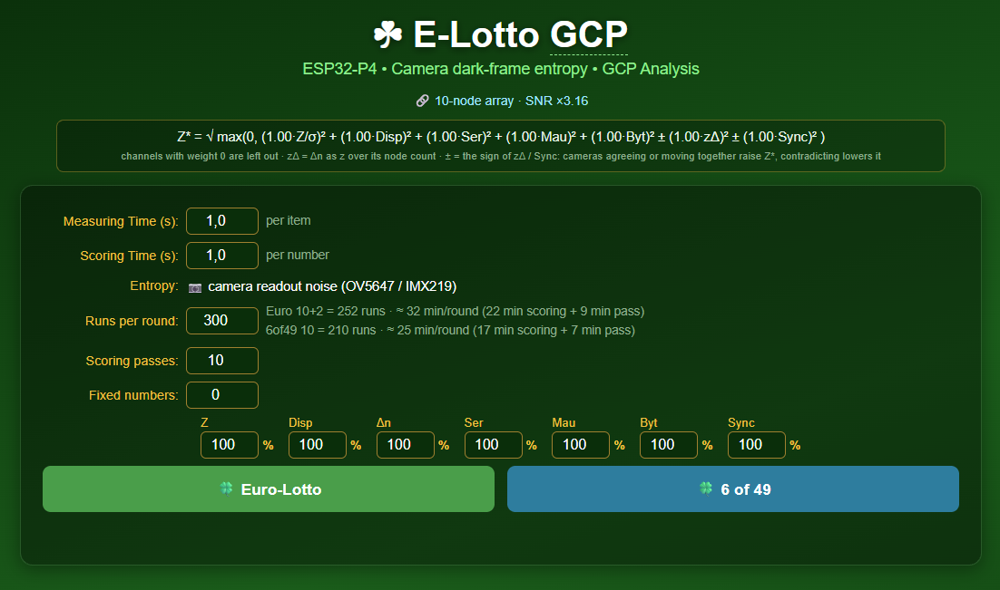
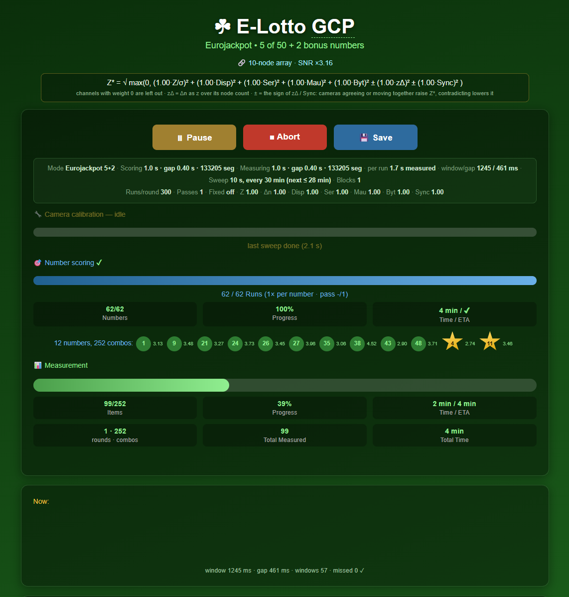
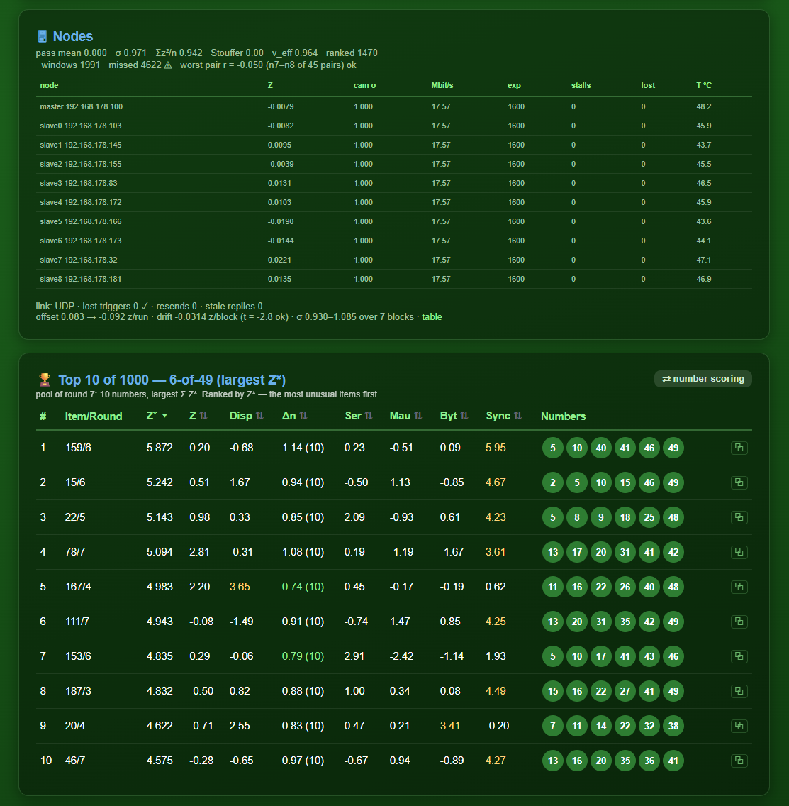

# E-Lotto — GCP Analysis on ESP32-P4

Ten-node ESP32-P4 array that ranks Eurojackpot and 6-of-49 numbers and combinations from
**camera readout noise in total darkness**, using
[GCP methodology](https://grokipedia.com/page/Global_Consciousness_Project).

**Rules and operator contract:** [`CLAUDE.md`](CLAUDE.md) ·
**Slave firmware:** [elotto_slave](https://github.com/hpheuer/elotto_slave)

## Authors

| | |
|--|--|
| **[hpheuer](https://github.com/hpheuer)** | Design, hardware, experiment, repository |
| **[Grok](https://x.ai)** (xAI) | Co-author — implementation, OTA validation, docs (Grok Build) |

## Abstract

A home-built GCP/PEAR-style instrument. Each node draws bits from its **own** camera (IMX219;
OV5647 also supported, never shared) in a totally dark enclosure at maximum analog gain: the
entropy is the sensor's readout noise. Frame-pair diff → LSB → segments of 224 bits → binomial
z per node. Nodes combine as `Σz/√k` over the k nodes that answered that window.

Every item is ranked on one key:

Z\* = √[ (γ·Z/σ_z)² + (ζ·Disp)² + (α·z_Δ)² + (ε·Ser)² + (β·Mau)² + (η·Byt)² + (κ·Sync)² ]

σ_z is the σ of the item's own block; Disp, Ser, Mau and Byt are window statistics of the
cameras (dispersion, serial order, Maurer compressibility, byte frequencies), each in σ of its
block. Sync is how much the cameras moved together inside the window, in σ of its block.
z_Δ is the node agreement Δn, pooled over all five channels, as a z (positive = the
cameras agreed more closely than independent ones, negative = they contradicted). Every channel
enters squared; Z, Disp, Ser, Mau and Byt count either sign, z_Δ and Sync count with their sign —
agreement and moving together raise Z\*, contradiction lowers it (Z\* never below 0). The weights `?kz=` (default 1) and
`?kdisp=` `?kdn=` `?kser=` `?kmau=` `?kbyt=` `?ksync=` (default 0) run 0..1; 0 leaves that channel out.
Scoring numbers and measuring combinations use the same key.

> This **cannot predict lottery draws**. Output is an experiment on physical randomness, not a
> betting tip. The ×√n array gain is **not established** — read `pass_σ` and the pairwise matrix
> before any table ([`CLAUDE.md`](CLAUDE.md)).

## In a nutshell (v3)

- **Rounds until Abort or 72 h:** score every number (`?passes=`, default 20) → measure a pool of
  up to `?maxruns=` combinations once each (default 100, max 400) → score again.
  `?maxruns=0` scores numbers only.
- **Windows:** `?run=` per combination, `?srun=` per number, each 0,2–22 s (default 5);
  pause between windows `?gap=` 0–10 s or `?gappct=` 0–100 % of the window (form field
  Gap (%), default 5).
- **Blocks:** one round = one block. Centring, drift, pairwise matrix, soft-down and a camera
  sweep candidate sit at the round boundary.
- **UI:** parameter line from `/status`, live "Now:" card, sortable Top-10 (Z\*, Z, Disp, Δn,
  Ser, Mau, Byt, Sync), camera-σ jump board, Log card. **Save** writes the session's files (CSV for a
  German Excel). A session is a closed unit — never compared or pooled with another.
- **Tools:** `tools/tune.html` — per-node exposure/health board (idle only).

## Screenshots

| Start | Session | Results |
|---|---|---|
|  |  |  |

## Hardware

| node | address | chip rev | role |
|---|---|---|---|
| master | 192.168.178.100 | v1.3 | web UI, session, combine, measure |
| slave0 | 192.168.178.103 | v1.3 | measure |
| slave1 | 192.168.178.145 | v1.3 | measure |
| slave2 | 192.168.178.155 | v1.3 | measure |
| slave3 | 192.168.178.83 | v1.3 | measure |
| slave4 | 192.168.178.172 | v3.2 | measure |
| slave5 | 192.168.178.166 | v3.2 | measure |
| slave6 | 192.168.178.173 | v3.2 | measure |
| slave7 | 192.168.178.32 | v3.2 | measure |
| slave8 | 192.168.178.181 | v3.2 | measure |

All ten: Waveshare ESP32-P4-ETH, **PoE**, one IMX219 each, enclosure totally dark with LEDs off.
Slaves are found by UDP broadcast (port 5000) at every session start — addresses are
informational. PSRAM is mandatory. USB is for recovery only. The v3.2 boards need their own
images (`build_rev3`, below).

## Build & Flash

```powershell
cd D:\E-Lotto\elotto
.\build.ps1 build                        # master
.\build.ps1 -C ../elotto_slave build     # slave, rev v1.3 boards
.\build.ps1 -C ota_firmware build        # factory updater
# rev v3.2 boards (slave4…slave8): own build dir and sdkconfig overlay; same pattern for ota_firmware
$s='D:\E-Lotto\elotto_slave'; .\build.ps1 -C $s -B "$s\build_rev3" -D "SDKCONFIG=$s\sdkconfig.rev3" -D "SDKCONFIG_DEFAULTS=$s\sdkconfig.defaults;$s\sdkconfig.defaults.rev3" build

curl.exe http://192.168.178.100/update --data-binary @build/elotto.bin
curl.exe http://192.168.178.103/update --data-binary @../elotto_slave/build/elotto_slave.bin
curl.exe http://192.168.178.172/update --data-binary @../elotto_slave/build_rev3/elotto_slave.bin
```

`build.ps1` sets up ESP-IDF v6.0.1 (with ccache) and forwards its arguments to `idf.py`.
`/update` answers 409 while a session runs — abort it first. After an OTA, poll `fw_sha` in
`/status` until it **changes**. A fresh board gets the updater over USB (`erase-flash`, `flash`
of `ota_firmware`), then Ethernet only. Details and recovery: [`CLAUDE.md`](CLAUDE.md).

## Project structure

```
main/            elotto.c (UI/HTTP), sensor.c/h, nodes.c/h, focus.c
components/      elotto_camera, elotto_gcp, elotto_link, elotto_ota  (shared with the slave)
ota_firmware/    factory recovery updater
tools/           tune.html (exposure/health board), wintest.py / winstat.py (direct window
                 test and per-node stats), elotto_autofilter.bas (LibreOffice sort arrows)
docs/            BITSCAN.md; STATUS / PLAN / PLAN_HISTORY / DECISIONS are stubs → git history
.claude/skills/  task instructions: flash, camlog, calibration, ranking-channels, ui
```

The slave repo must sit **next to** this one (`EXTRA_COMPONENT_DIRS=../elotto/components`);
build, flash and commit both together.

## Version

| | |
|---|---|
| **v3** | Rounds until Abort or 72 h; block = round; Z\* product key; ten nodes, IMX219 in the dark. Contract: `CLAUDE.md`. |
